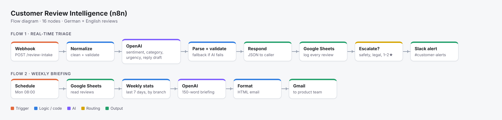
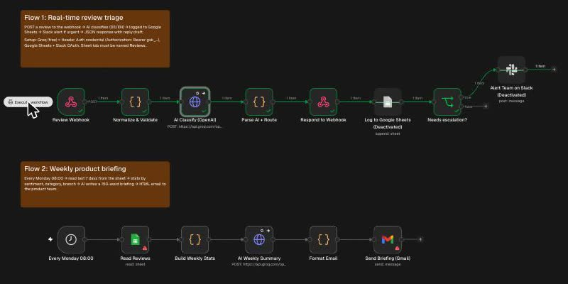

# Customer Review Intelligence — n8n + LLM (Groq or OpenAI)

An n8n automation that turns raw customer reviews (German and English) into **structured data, urgent alerts and a weekly product briefing**, for a (fictional) car rental company.

The problem: reviews arrive from Google, Trustpilot and app stores in two languages. Someone reads them by hand, urgent ones (safety, legal threats) get missed, and product managers never see the patterns.



**Real test run in n8n (self-hosted, Groq):** green = executed.



## What it does

**Flow 1 — real-time triage (webhook)**
1. A review is POSTed to the webhook
2. Code node cleans and validates the input
3. An LLM (tested with Groq `openai/gpt-oss-120b`; OpenAI `gpt-4o-mini` in `workflow.json`) returns language, sentiment, category, urgency, an English summary and a reply draft *in the customer's language*
4. The AI output is validated against allowed values. **If the AI call fails or returns junk, a rule-based fallback is used and the review is flagged for a human**, so nothing is lost
5. The caller gets a JSON response immediately
6. Every review is logged to Google Sheets
7. Urgent reviews (safety, legal threat, 1–2 stars + negative, or AI failure) go to Slack `#customer-alerts` with the suggested reply

**Flow 2 — weekly briefing (schedule)**
Every Monday 08:00: reads the last 7 days from the sheet → counts by sentiment, category and branch → AI writes a 150-word briefing (trend, top 2 problems with numbers, one suggestion) → HTML email to the product team.

## Design decisions
- **Structured output + validation** instead of trusting free text from the model
- **Retries (3x) and continue-on-error** on the API call, with a fallback path
- **Human in the loop**: AI drafts replies, a person sends them
- Cheap model for classification; costs a fraction of a cent per review

## Run it for free
Two things normally cost money here: n8n Cloud and the OpenAI key. Both have free alternatives:
- **n8n:** the self-hosted Community edition is free. Install Docker Desktop, then run
  `docker run -it --rm -p 5678:5678 -v n8n_data:/home/node/.n8n n8nio/n8n` and open http://localhost:5678.
- **AI model:** import **`workflow-free-groq.json`** instead of `workflow.json`. It calls Groq, which has a free tier without a credit card. Create a key at console.groq.com and use it in a *Header Auth* credential: name `Authorization`, value `Bearer gsk_...`.
- The model is set in the "Normalize & Validate" and "Build Weekly Stats" nodes (`openai/gpt-oss-120b`). If Groq has renamed or removed it, pick another model from the list at console.groq.com and change it there. If you get an error about `response_format`, delete that line in "Normalize & Validate"; the parse step already handles messy output.
- Free tiers have rate limits. Fine for testing with the sample reviews, not for thousands of reviews.

## Setup (about 15 minutes)
1. n8n Cloud trial or self-hosted (`docker run -it --rm -p 5678:5678 n8nio/n8n`)
2. *Workflows → Import from File →* `workflow.json`
3. Credentials:
   - **OpenAI**: create a *Header Auth* credential, name `Authorization`, value `Bearer sk-...`, select it in both "AI" nodes
   - **Google Sheets**: OAuth; create a sheet with a tab named `Reviews` and paste its URL into both Sheets nodes. Add this header row:
     `review_id, received_at, source, branch, author, rating, text, language, sentiment, category, urgency, summary_en, reply_draft, ai_status, ai_error, needs_escalation`
   - **Slack** and **Gmail**: OAuth; set your channel and recipient
4. Click *Test workflow*, then send the samples:
   ```bash
   ./send_samples.sh https://YOUR-N8N/webhook-test/review-intake
   ```

`sample_reviews.json` contains 5 test reviews: a German pickup complaint, a positive English review, a German legal threat about a damage charge, an app bug, and a safety issue.

## Results (real run, 8 Nov 2026)
Self-hosted n8n (Docker) + Groq free tier, model `openai/gpt-oss-120b`, the 5 reviews from `sample_reviews.json`. Google Sheets and Slack were switched off for this test (not connected yet); everything else ran for real.

| Review | AI result | Escalated |
|---|---|---|
| DE, 1★, 50 min wait at counter | negative · pickup_wait · German reply draft | yes |
| EN, 5★, quick pickup, clean car | positive · English reply draft | no |
| DE, 2★, charged for old scratch, legal threat | negative · damage_claim · urgency high | yes |
| EN, 3★, app crashes adding a driver | neutral · booking_app | no |
| EN, 1★, brake warning light, hotline unreachable | negative · car_condition · urgency high | yes |

- Escalation: 5/5 as expected. Reply language matched the review: 5/5.
- Category: 4/5 ideal. The brake review was labelled `car_condition`; `safety` would have been better. It was still escalated because urgency was high.
- One reply draft contained a placeholder (`[phone/email]`). That's why drafts go to a human before anything is posted.
- First run failed with `401 Invalid API Key` (credential typo). The fallback kicked in as designed: the review was still answered, logged and flagged instead of being lost.

## Next steps
- Pull reviews automatically from the Google Business Profile API instead of the webhook
- Approve-and-send replies from Slack buttons
- Dashboard in Looker Studio on top of the sheet
