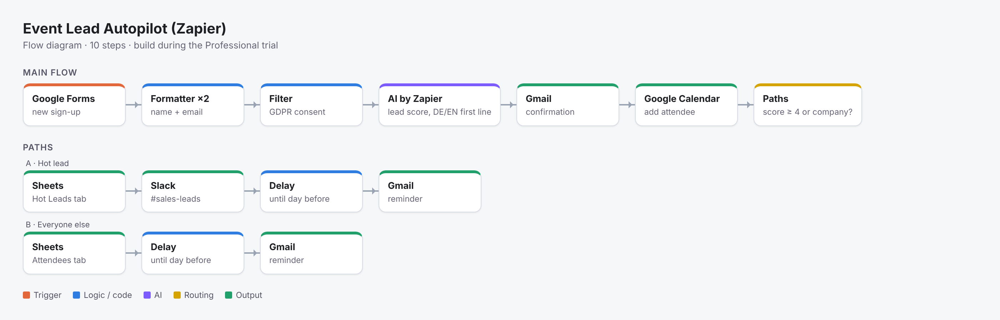

# Event Lead Autopilot — Zapier + AI

A Zapier automation that handles everything after someone signs up for an event (a fictional customer event of the car-rental company): **cleaning the data, GDPR consent check, AI lead scoring, a personalised confirmation in German or English, calendar invite, sales alert for hot leads, and a reminder the day before.**

The problem: marketing teams copy sign-ups from forms into spreadsheets by hand, send generic emails, and sales finds out about interesting companies days later.



## The Zap (10 steps)

```
1  Google Forms      New Form Response
2  Formatter         Text → Titlecase (name)
3  Formatter         Text → Lowercase (email)
4  Filter            Only continue if consent = "Yes" and email contains "@"
5  AI by Zapier      Score lead + write personal first line (DE/EN)
6  Gmail             Send confirmation email (language from step 5)
7  Google Calendar   Add attendee to the event
8  Paths
   ├─ A "Hot lead"   (lead_score ≥ 4 OR type = Company)
   │     8A.1 Google Sheets  Create row in tab "Hot Leads"
   │     8A.2 Slack          Message to #sales-leads
   │     8A.3 Delay Until    1 day before event
   │     8A.4 Gmail          Reminder email
   └─ B "Everyone else"
         8B.1 Google Sheets  Create row in tab "Attendees"
         8B.2 Delay Until    1 day before event
         8B.3 Gmail          Reminder email
```

## Design decisions

- **GDPR gate first.** The consent filter runs before any AI call, sheet row or email. Without consent, nothing is stored or sent.
- **AI returns fields, not prose.** The AI step outputs `lead_score` (1–5), `reason`, `first_line` and `greeting` as separate fields. Routing uses the numeric score, so a creative answer from the model can't send a lead down the wrong path.
- **A rule backs up the AI.** Every sign-up of type "Company" goes to sales, whatever score the AI gives. A business-critical lead never depends on the model alone.
- **Scoring rubric in the prompt.** Each score has a written definition (5 = possible B2B customer, 1 = unclear), so results are consistent and explainable to the sales team.
- **Language follows the customer.** The confirmation and greeting are written in the language chosen in the form.

## Test plan

`test_signups.csv` contains 6 sign-ups with the expected result for each:

| Sign-up | Expected |
|---|---|
| German student, clear goal | Path B, German email |
| Company managing 300 company cars | Path A, Slack alert |
| German travel-agency professional | Path A or B, depending on score |
| English student, "just curious" | Path B, English email |
| Travel startup asking about partnership | Path A, Slack alert |
| No consent given | Stopped at the filter, nothing stored |

## Files

- `docs/zap-diagram.png` — the flow
- `docs/SETUP.md` — step-by-step build guide, including the full AI prompt
- `email_templates.md` — confirmation and reminder emails (DE/EN)
- `test_signups.csv` — test data with expected results

## Plan note
Zapier's free plan only runs two-step Zaps. The full flow runs on the 14-day Professional trial. A two-step version that keeps running on the free plan: *Google Forms → Google Sheets*.
