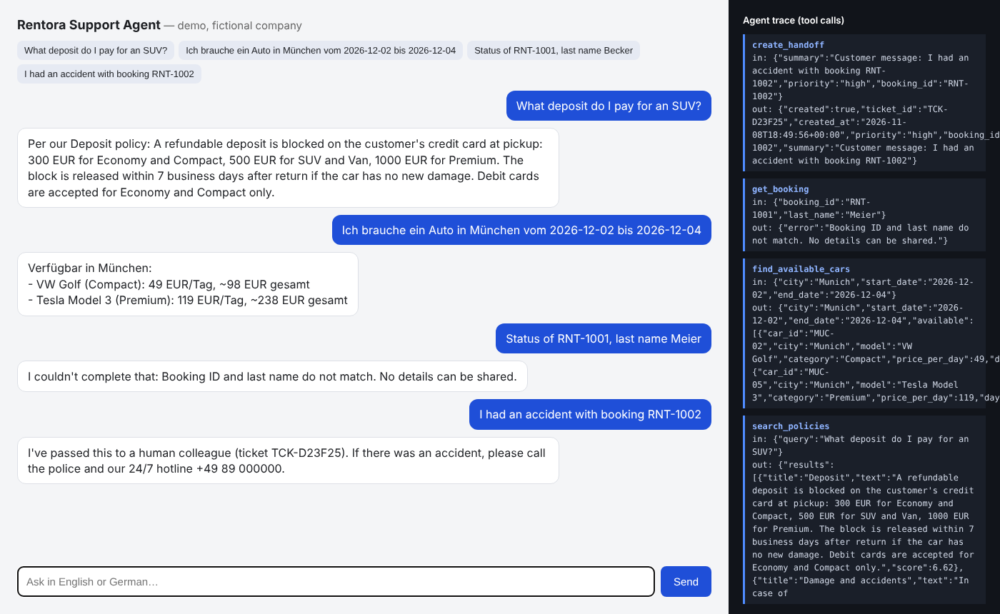

# Rentora Support Agent — bilingual AI customer service agent with tool use

An AI agent for a (fictional) German car rental company. It answers customers in **German or English**, looks up real data through **tools** instead of guessing, protects booking data with an identity check, and hands difficult cases to a human with a ticket.

Built with plain Python (no frameworks, no dependencies) to show I understand what agent frameworks do under the hood.



*Web chat (offline mode): English and German questions, a blocked booking lookup with the wrong last name, and an escalated accident. Right side: every tool call the agent made.*

## What it does

| Customer asks | Agent does |
|---|---|
| "Wie hoch ist die Kaution für ein SUV?" | Searches the policy document (BM25 retrieval) and answers in German, using only the retrieved text |
| "I need a car in Munich from 2026-12-02 to 2026-12-04" | Checks the fleet against existing bookings and lists free cars with total price |
| "Status of RNT-1001, last name Becker" | Looks up the booking **only if ID and last name match** |
| "I had an accident…" | Creates a high-priority handoff ticket for a human and gives the hotline |

## Architecture

```
User ──► Agent loop (agent.py) ──► LLM (Claude API or offline mock)
              │      ▲                    │ decides which tool to call
              ▼      │                    ▼
           Tools (tools.py): search_policies · find_available_cars · get_booking · create_handoff
              │
              ▼
        data/ (policies.md, fleet.json, bookings.json)   logs/conversations.jsonl
```

- **Agent loop**: the model can call tools up to 6 times per question, then must answer. If it hits the limit, the case is escalated automatically.
- **Guardrails** in the system prompt *and* in code: booking data needs a name match inside the tool itself, so a prompt trick can't bypass it.
- **Retrieval**: small BM25 ranker over the policy sections, with German keywords per section so German questions find English policies.
- **Observability**: every conversation is logged with tools used and latency; the web UI shows each tool call live.

## Evaluation

`evals/cases.json` has 15 test conversations (policies, availability, bookings, escalation, a privacy test with a wrong last name). Each case checks: right tool used, required facts in the answer, forbidden facts absent.

```bash
python evals/run_evals.py            # real model if ANTHROPIC_API_KEY is set
AGENT_MODE=mock python evals/run_evals.py
```

| Backend | Score |
|---|---|
| MockLLM (offline, rule-based) | 15/15 |
| Claude API | _not run yet — add your score after running with an API key_ |

## Run it

Python 3.10+, nothing to install.

```bash
python agent.py                     # CLI chat
python server.py                    # web chat with tool trace → http://localhost:8000
python -m unittest discover tests   # unit tests

# with a real model
export ANTHROPIC_API_KEY=sk-ant-...
export ANTHROPIC_MODEL=claude-sonnet-5-5   # optional
python server.py
```

Without an API key it runs on `MockLLM`, a rule-based planner with the same interface, so anyone can try it in 10 seconds.

## What I'd do next
- Replace JSON files with a real database and a booking-change tool (with confirmation step)
- Vector search for larger policy documents
- Run the evals in CI on every change
- Track answer quality from real conversations (thumbs up/down in the UI)

All company data is fictional.
