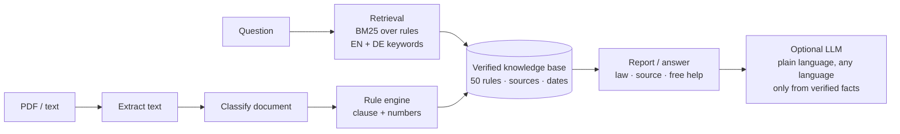

# Student Rights Check

**Know your rights as a student in Germany, before someone takes advantage of them.**

Student Rights Check does two things:

1. **Check a document.** Give it a contract or letter (WG lease, Werkstudent or Minijob contract, internship contract, gym contract, Abmahnung) and it points out clauses that commonly trap students.
2. **Answer a question.** Ask *"I was sick on my exam day, what now?"* or *"My landlord came into my room without asking"* and it answers from a hand-checked knowledge base of student rights.

Every answer shows what the law generally says, the exact paragraph, a link to the source, and where to get free help. If the tool doesn't have a verified rule for your question, it says so instead of guessing.

---

## Why I built this

Around me as a student in Germany, the same stories keep coming up: someone pays a deposit that was never legal, works below minimum wage because "that's what Werkstudenten get", misses an exam and loses the attempt because they didn't know the rules, or is stuck in a gym contract for another year. People usually find out what their rights are after the damage is done.

Lawyers are expensive, and free advice exists (Mieterverein, Verbraucherzentrale, student council), but most students don't know that or don't know when they need it. This tool is the first step: it tells you **that** something is wrong, **what** the law says, and **who** can help you for free.

## What it covers

50 verified rules across 10 areas of student life (`python -m rightscheck topics` lists them all):

| Area | Examples |
|---|---|
| **Studies & exams** (Bavaria) | Sick on exam day, objecting to a grade, seeing your marked exam, Nachteilsausgleich, maternity protection |
| **Werkstudent, Minijob, internships** | Minimum wage, unpaid internships, 20-hour rule, Minijob limit, holiday jobs, equal pay for Minijobbers, working hours and breaks, sick pay, holiday, notice periods, termination by e-mail, payslip and reference, forbidden interview questions |
| **International students** | 140/280 working days rule |
| **Housing & WG** | Deposit limit and return, notice periods (yours and the landlord's), fixed-term leases, Mietpreisbremse and rent increase cap in Munich, utility bills, painting when moving out, rent reduction for mould/pests, landlord entering your room, subletting, flat applications, address registration |
| **Money** | BAföG, Wohngeld, Kindergeld, Rundfunkbeitrag exemption, getting tax back, right to a bank account |
| **Health insurance** | Family insurance until 25, student rate until 30 |
| **Contracts** | 14-day withdrawal for online purchases, gym contracts, phone contracts (max. 24 months), online cancel button, unordered goods |
| **Data protection** | Asking any company what data it has about you |
| **Discrimination** | Being rejected for a flat because of your origin |
| **Abmahnung** | Capped lawyer fees, don't sign before checking |

### Contract checks (red flags it finds automatically)

| Document | Flags |
|---|---|
| WG / rental contract | Deposit above 3 cold rents · full deposit up front · tenant notice > 3 months · fixed term without reason · rigid painting schedule · rent reduction excluded · landlord may enter any time · subletting banned · registration not allowed · rent increase > 15 % · WG-scam signals |
| Werkstudent / Minijob / internship | Wage below minimum wage · too little holiday · no sick pay · no job reference · termination by e-mail · probation > 6 months · Werkstudent > 20 h · Minijob above 603 € · unpaid voluntary internship > 3 months |
| Gym / phone / subscription | Renewal for another fixed term · notice > 1 month · phone contract > 24 months · "no right of withdrawal" |
| Abmahnung | Lawyer fees on more than 1,000 € · declaration to sign |
| Any document | Deadlines |

## Examples

```
$ python -m rightscheck ask "My landlord came into my WG room without asking"

## Your landlord may not enter your room without your consent
Hausrecht des Mieters; § 307 BGB; Rechtsprechung
Once you rent a flat or room, you hold the right to decide who enters. The landlord needs
a concrete reason, must announce the visit in advance and needs your consent. Only in a
real emergency (burst pipe, gas leak, fire) may he enter without asking. ...

## Where to get free help
- Mieterverein in your city (e.g. Mieterverein München; ...)
```

```
$ python -m rightscheck check samples/wg_mietvertrag_2.txt

Result: 3 red flag(s), 1 to get checked
1. [RED FLAG] Defects (mould, pests, no heating): the rent is reduced by law
   > § 3 Eine Mietminderung wegen Mängeln ist ausgeschlossen.
2. [RED FLAG] Your landlord may not enter your room without your consent
   > § 2 Der Vermieter ist berechtigt, das Zimmer jederzeit auch ohne Ankündigung zu betreten.
3. [RED FLAG] Register your address within 2 weeks; the landlord must confirm
4. [GET IT CHECKED] Subletting part of your flat: you can ask for permission
```

```
$ python -m rightscheck ask "What is the best pizza in Munich?"

I couldn't find a verified rule for this question, so I won't guess.
```

## How it works



**The key design decision: the AI never invents the law.**

A wrong answer here costs a student real money or an exam attempt. So the work is split:

1. **Knowledge base (`knowledge_base/laws.json`)**: every legal statement the tool can make, checked by hand against the law text or an official source, with a link and a verification date. Values that change (minimum wage, Minijob limit) are stored per year and switch automatically.
2. **Rule engine (`rules.py`)**: deterministic. Finds the clause, pulls out the numbers (rent, deposit, wage, hours, days) and does the maths.
3. **Retrieval (`ask.py`)**: a small BM25 search over the rules with English and German keywords, so students can ask in either language. Below a confidence threshold it refuses to answer and points to free advice.
4. **LLM layer (`llm.py`)**: optional. It only gets the verified rules and turns them into simple language in the student's own language. The system prompt forbids new laws, numbers or case-specific advice.

## AI agent mode

`python -m rightscheck agent "<message>" [--file contract.pdf] [--trace]`

Here the model decides what to do. It has two tools, both backed by the tested code above: `check_document` (red-flag checks on the attached document) and `search_rights` (the 50 verified rules). It can combine them, e.g. check a lease, look up a related right, and draft a polite message to the landlord.

Illustrative trace:

```
$ python -m rightscheck agent "Is this okay? Write my landlord a short message." --file samples/wg_mietvertrag.txt --trace
[tool] check_document {}
[tool] search_rights {"question": "deposit instalments"}
[grounded] True
...
```

The safety rule is enforced in code, not only in the prompt: every law reference (`§ …`, `Art. …`) in the answer must appear in a tool result. If the model cites something no tool returned, it gets one chance to fix it; after that the agent shows the verified tool results instead. There is also a step limit, and unknown tool names are rejected.

The agent tests (`tests/test_agent.py`) use a scripted fake model, so they run offline: tool use, the retry on an invented paragraph, the fallback, missing document, unknown tool and the step limit. The live agent needs `ANTHROPIC_API_KEY`.

## Staying legal: information, not legal advice

In Germany, legal advice on an individual case is regulated by the Rechtsdienstleistungsgesetz (RDG). General legal information is allowed. A disclaimer alone doesn't make advice legal, so the tool is **built** to stay on the information side:

- It says what the law **generally** says and mentions common exceptions. It never says "you will win" or "do X".
- "Red flag" only where a clause clearly conflicts with a rule. Everything that depends on details is "get it checked".
- Every answer ends with free services that **are** allowed to advise (Mieterverein, Verbraucherzentrale, student council legal advice, international office).
- Documents and questions are processed in memory and not stored (GDPR).

More detail in [docs/LEGAL.md](docs/LEGAL.md).

## Run it

```bash
git clone https://github.com/shahidkhn23/automation-ai-portfolio.git
cd automation-ai-portfolio/06-student-rights-check
pip install -e ".[dev]"

python -m rightscheck topics                                        # everything it knows
python -m rightscheck ask "Can I work 25 hours as a Werkstudent?"   # ask a question
python -m rightscheck check samples/werkstudent_vertrag.txt         # check a contract
python -m rightscheck check my_contract.pdf --json                  # structured JSON
export ANTHROPIC_API_KEY=...                                        # optional
python -m rightscheck ask "Was passiert wenn ich krank bin?" --ai --lang Deutsch
pytest                                                              # run the tests
```

## Quality

- **57 tests**: every sample contract, number parsing, 29 real student questions in English and German, the minimum wage switch on 1 Jan 2027.
- **Precision test:** a fair contract (`samples/fairer_vertrag.txt`) must produce zero warnings, and an unrelated question must get no answer. A tool that warns about everything or answers everything is useless.
- **Integrity tests:** every rule has an area, a source link and keywords; every answer only contains text from the verified knowledge base.

## Roadmap

- [x] v0.1: contract check for leases, work contracts, gym contracts, Abmahnung
- [x] v0.2: all student-rights areas, "Ask about your rights" mode, Bavarian exam law
- [x] v0.3: 50 verified rules, 27 automatic contract checks
- [x] v0.4: AI agent mode with tool calling and a code-enforced grounding check
- [ ] OCR so students can upload a photo of a letter
- [ ] n8n workflow: upload → check → deadline into Google Calendar → reminder e-mail
- [ ] Zapier version: forward a letter by e-mail, get the explanation back
- [ ] Simple web app for non-technical users
- [ ] Exam rules for other federal states
- [ ] Official letters (Finanzamt, Rundfunkbeitrag, Krankenkasse): "what do they want from me" + deadline
- [ ] Feedback button "was this correct?" to measure precision with real users
- [ ] Pilot with fellow students to measure which answers they find useful

## Author

Shahid Saleem · B.Sc. Artificial Intelligence, TH Rosenheim · [github.com/shahidkhn23](https://github.com/shahidkhn23)

_Disclaimer: Student Rights Check provides general legal information, not legal advice. It does not replace a lawyer or an advice service._
